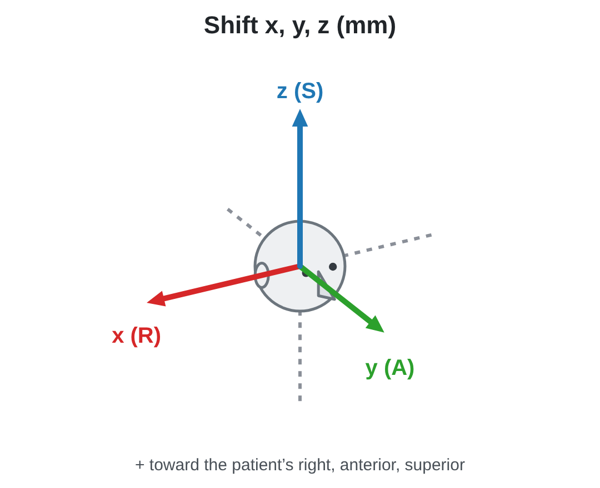
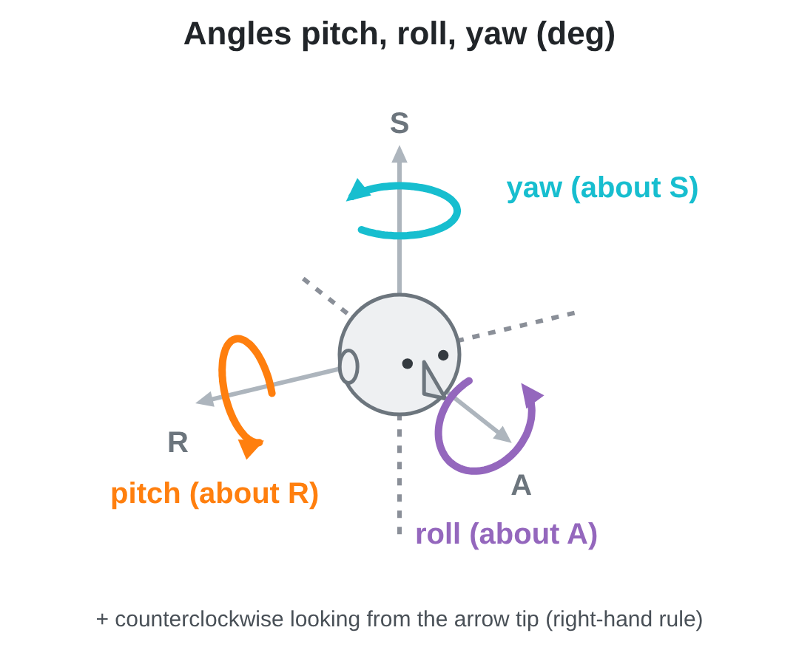

# DICOM Gated / Dynamic PET (3D Slicer)

A DICOM plugin that loads **ECG gated** and **dynamic** PET series as sequences, in SUV (body weight, lean body mass or body surface area) or Bq/ml, and keeps
the tracer, decay correction and frame timing with every volume. Plain static PET loads too.

> **Intended use.** Research software. It is not a certified medical device and must not be used for
> clinical diagnosis.

## Why

Slicer's PET SUV plugin (PETDICOMExtension) targets static PET, and the MultiVolume importer handles time
series generically. Gated and dynamic PET series are stacks of single-slice images, one per slice and frame.
Those plugins often stack such a series into one volume, fail to split it, or lose the per-image rescale
slope, the per-frame timing and the decay correction. This plugin fills that gap, and loads static PET too
(see *Static PET* below).

## What it loads

The series shows up in the DICOM browser with one loadable per unit; the first one is selected.

| Series | Recognised by | Loadables (selected first) | Result |
|---|---|---|---|
| Gated | Series Type `GATED\IMAGE`, or Number of Time Slots (0054,0071) > 1 | *gated SUVbw*, *gated Bq/ml* | **mean of the gates** (static image) + sequence of gates (index *Gate*) |
| Dynamic | Series Type `DYNAMIC\IMAGE`, or Number of Time Slices (0054,0101) > 1 | *dynamic Bq/ml*, *dynamic SUVbw* | sequence of time frames (index *Time*, s) + **frame timing table** |
| Static | any other PT series | *SUVbw*, *Bq/ml* | one volume |

An explicit Series Type wins over the frame counts (a `DYNAMIC` series with Number of Time Slots > 1 stays
dynamic); the counts decide only when the Series Type is missing or unknown.

- Images are split into frames by Image Index (0054,1330), else Trigger Time (gated) or Frame Reference
  Time / acquisition time (dynamic), else repeated slice positions, and sorted along the slice normal.
  Every image keeps its own rescale slope.
- Sequences come with a browser and a *(current gate)* / *(current frame)* volume, one window for all
  frames (no flicker in cine), in the series' patient/study folder.
- Each gate of a gated PET is a full activity image, so the static image is the **mean** of the gates. It
  is paired with the gates (`MPI.GatedSequence`), so the Tarvos (Myocardial Perfusion) extension lists one
  study with its gated sequence.
- Dynamic series load in Bq/ml first, the usual unit for kinetic modelling.

### Incomplete series

Missing frames and slices do not stop the loading; the series loads with what is there and the user is
warned (a message after loading, the Python log, and the `LoadWarnings` attribute on every volume).

- The DICOM browser already shows a warning on the loadable when the series has fewer images than the
  header announces (frames x Number of Slices).
- A **missing gate or time frame** is left out. The others keep their own numbers (gates *1, 2, 4*), so
  gate attributes and frame timing stay right.
- A **missing slice** keeps its place on the slice grid shared by all frames, so the frames keep the same
  geometry. When the frame has slices before and after it, it is linearly interpolated from the nearest
  ones along the slice axis (the same result as hardening Slicer's acquisition geometry regularization
  transform for a scalar volume with a gap). Missing slices at the top or bottom of the stack are left
  empty (0). The mean of the gates and the dynamic summed volume take each slice from the frames that
  really have it, and use the interpolated slices only where no frame has it.
- Duplicate images at one slice position are skipped. With uneven slice spacing the volume is built with
  the median spacing.

## Settings

The **Gated / Dynamic PET Settings** module (Nuclear Medicine > PET4D) sets the loader's defaults. Changes are
saved at once and apply to series examined in the DICOM browser afterwards.

| Setting | Choices | Default |
|---|---|---|
| SUV method | body weight (SUVbw), lean body mass (SUVlbm / SUL, Janmahasatian), body surface area (SUVbsa, Du Bois) | SUVbw |
| Loadable selected first, per static / gated / dynamic | SUV or Bq/ml | SUV, SUV, Bq/ml |
| Summed volumes, gated / dynamic | on or off | on, on |
| Dynamic PET: weight the frames by counts (simulate a static scan) | on or off | off |

- Every series offers the chosen SUV and Bq/ml; the other one stays in the list, unselected.
- SUVlbm needs the patient height and sex (M / F), SUVbsa the height. Without them the series offers SUVbw,
  and the DICOM browser says why.
- **Gated summed volume:** the mean of the gates (see below). Tarvos lists a gated PET study through this
  image, so keep it on for Tarvos.
- **Dynamic summed volume:** *"<series> summed Bq/ml"*. The frames are summed by their durations, which is
  the duration-weighted mean, so the values stay in Bq/ml or SUV: the time average of the decay corrected
  concentration over the acquisition.
- **Weight the frames by counts** (off by default) makes the summed volume what **one static acquisition of the
  same time** would show instead. Each frame is weighted by the counts a constant activity gives in it,
  `w_i = exp(-λ (s_i - s_1)) (1 - exp(-λ d_i)) / λ` (s = frame start, d = duration, λ = ln 2 / half life), so the
  early frames weigh more: for C-11 over 90 min the last minute weighs about 5 % of the first. With decay corrected
  frames, `Σ C_i w_i / Σ w_i` is exactly the value of a static frame decay corrected to its start. Frames that are
  not decay corrected already are counts per second, so their duration weights are the static acquisition. Without
  the frame starts or the half life the durations are used. The setting is written on the summed volume and the
  sequence (`DynamicPET.SumWeighting` = `duration` or `counts`, with the weighting used in `StaticFrom`), and
  Motion Correction resums with it. It links to its sequence
  (`DynamicPET.DynamicSequence`) and carries the total duration and the first start / last end from the
  injection.
- With a summed volume off, the sequence's *(current gate/frame)* volume is shown instead.

## Dynamic PET Review/Edit

The **Dynamic PET Review/Edit** module (Nuclear Medicine > PET4D) reviews a dynamic series frame by frame. Pick the dynamic
sequence (the most recent one is picked for you) and press *Open Review/Edit*:

- **Upper 2/3:** a large axial view of the current frame, and next to it a near-square grid of small axial
  views, one per frame (5 frames: 2 x 3, 20 frames: 4 x 5). The views are linked (Slicer's view link,
  on by default, in their own view group): changing the orientation, slice, zoom or pan of any view, large or
  small, changes all of them.
- **Lower 1/3:** a timeline dock. The ruler has three rows: clock time, time from the study start and time
  from the injection (each when the header tells it). Under it is one block per frame, each as wide as the
  frame's duration. The toolbar line gives the current frame's start - end in all three. Click a block to show that frame. Ctrl / Shift + click selects
  frames, and Left / Right step through them.
- **Play** runs in acquisition time: each frame stays on screen for its duration, scaled by the speed shown
  next to *Slower* / *Faster* (halve / double). The default plays the whole series in 60 s (a 90 min series at
  x90, 1 s = 1:30). It plays the timeline's time window and loops.
- **Time window:** a two-handle slider with spin boxes (seconds from the study start), like a volume's display
  range, zooms the timeline into part of the series. The mouse wheel over the timeline also zooms, around the
  cursor, and Shift + wheel pans in time. *Show all* (or a double click on the timeline outside the curves) goes
  back to the whole series.
- **Curve zoom:** Ctrl + wheel over the time-activity curves zooms their value axis (from 0 up; points above the
  top are cut off), and a double click on the curves resets it.
- **Overlays:** each view shows its frame number and its start - end time from the study start in the top
  left corner. The current frame is highlighted.
- **Window** (module panel): one display range for all frames (min / max slider, *Auto* = 0 to the highest
  99.9th percentile; dragging the window in the large view changes all frames too), or *each frame automatic*
  (0 to its own 99.9th percentile, so late low-count frames stay visible), and the color map: the Tarvos (MPI)
  maps (PET-DICOM, Hel, PET-HotIron, Jotun, Vanaheim, Valhalla, Trugold) and Slicer's Inferno, PET maps and grey.
- **Fusion** (module panel): pick a background volume (CT / MR); every view shows it under its PET frame, with a
  PET opacity slider.
- **ROIs** (module panel): see *Spherical ROIs and time-activity curves* below.
- **Close Review/Edit:** goes back to the previous layout and removes the helper volumes and the sphere models. ROI
  points stay in the scene, and the next *Open Review/Edit* takes them up again.

Series longer than *Frame views (max)* (64 by default) show that many frames, spread over the series.

### Editing the frames

The *Series* box also takes a **static PET** volume: it opens as a one-frame series, so a dynamic series can be
built from several static scans (add them, then *Save as...*). The bar above the timeline edits the frames:

- **Add frame** + series box + **Add...**: the box lists the PET in the scene, *(static)* volumes and *(dynamic)*
  sequences (gated PET is not offered). *Add...* opens a dialog with both series side by side: patient, units,
  injection time, acquisition start / end, acquisition time, number of frames, decay correction and its
  reference time, half life and scanner. The frames are placed by their **acquisition clock time** (the series
  start, not the study time).
  - Refused: SUV with Bq/ml, different SUV normalisations, different radionuclides or half lives, Bq/ml decay
    corrected with Bq/ml that is not, unknown acquisition times, frames overlapping the edited series.
  - Warned: different patient name or ID, a different scanner (manufacturer, model, serial number, station), a
    different injection time, more than 60 min between the two series.
  - **Decay correction:** SUV is normalised to each series' own decayed dose, so SUV values join as they are.
    Bq/ml series decay corrected to different times are put on the decay reference of the series that **starts
    first**: the other one is multiplied by 2^((its reference - that reference) / T1/2), so the values are
    continuous. When the added series starts first, the frames already there are corrected.
  - When the image grid differs (size, voxel size, position, orientation, or a transform), Review/Edit asks
    whether to **resample** it onto the grid of the edited series (linear, no registration). A frame kept on its
    own grid cannot be merged with others. After adding, it reminds you to check the registration and, if needed,
    to correct it in *Dynamic PET Motion Correction* after saving.
- **Merge**: the selected neighbouring frames (Ctrl / Shift + click) become one, the **duration weighted mean**;
  its duration is the sum of the acquisition times. Frames with a gap between them are merged after a question.
- **Split**: a merged frame goes back to the frames it was made of (frames added from another series come back
  as they were added).
- **Remove**: the selected frames are left out. The other frames keep their values: decay correction is to a
  fixed reference time, not to the first frame, and that time is written to the saved series.
- **Discard changes**: back to the original series (after a question).
- **Undo** / **Redo** (Ctrl+Z, Ctrl+Y): every edit above, Discard changes too, can be undone and redone until the
  series is saved.

Once something is edited, the original timeline stays at the bottom at half height, **locked** (it zooms and pans
with the edited one, but frames cannot be clicked; the frames of the current edited frame are outlined), and the
**edited timeline** above it shows the edited frames in **red**. The views show the edited frames at once; the
original sequence is not changed.

- **Save as...** asks for a name and makes a new dynamic sequence with its browser, frame timing table and summed
  volume (weighted as the original's), next to the original in the subject hierarchy.
- **Overwrite original** (after a question) replaces the frames of the sequence, its frame timing table and its
  summed volume. A series opened from a static volume can only be saved as a new one.

- **Export to DICOM...** (when there are no unsaved edits): see *DICOM export* below.

After saving, the saved series is opened again with a plain timeline. Edited frames carry
`DynamicPET.EditSources` (what they are made of, e.g. *F2 + F3 (merged)*), the timing tags are written again
(the study start is the new first frame; `StartSource` says *Review/Edit: ...*), and a decay alignment is kept in
`DynamicPET.EditDecayReference`.

### Spherical ROIs and time-activity curves

Press *Add spherical ROI* and click in the large (left) view. Right click or Esc cancels. The ROI is a point
with a sphere around it, in a color of its own, shown in the large view only. Drag the point to move it. The
radius box (mm, 10 by default) sets the radius of new ROIs and of the ROI selected in the list. *Remove* and
*Remove all* delete ROIs.

Every ROI has a time-activity curve, drawn on the timeline between the ruler and the frame blocks (which become a
shorter track while there are curves):

- The curve has one point per frame, in the **middle** of the frame ((start + end) / 2), on the same time axis
  as the ruler and the frame blocks, so it follows the time window. Faint vertical lines mark the frame boundaries.
- The value is the **mean over the voxels whose centres are inside the sphere**, in the series' units (Bq/ml or
  SUV). A sphere smaller than a voxel uses the nearest voxel. A frame in which the sphere is outside the volume
  has no point, and the line breaks there.
- The current frame's points are larger. Hover over a point for the ROI, the frame and the value. Clicking in
  the plot picks the frame, like clicking its block.
- The curve is computed about 0.1 s after the point or the radius last changed, from all frames of the sequence.
  When the volume is under a transform, the point is mapped into it, so a linear transform with scaling changes
  the sphere's size in the volume.

The ROI points are fiducial nodes with the attributes `ReviewEdit.SphereROI` = 1, `ReviewEdit.RadiusMm` and
`ReviewEdit.Color`. They are saved with the scene. They show only in the large view, so they are hidden in other
layouts.

### SUV

SUVbw follows the QIBA vendor-neutral pseudo-code: weight, injected dose decayed to the decay reference.
SUVlbm and SUVbsa use the same decayed dose, with the lean body mass (g) or the body surface area (cm2) in
place of the weight (`SUVMethod`, `LeanBodyMassKg`, `BodySurfaceAreaM2` are stored on the volumes).

- *Decay Correction START*: the dose is decayed to the series time (or GE's scan start when the series time
  is later than the acquisition, else the first acquisition time); one scale for every frame.
- *ADMIN*: no decay.
- *NONE* (frames not decay corrected): a dynamic series is **decay corrected on request**. The DICOM browser
  warns about it, and loading asks whether to correct the frames to the start of the first frame, like a
  START series (time activity curves and kinetic modelling need it). Frame *f* is multiplied by
  2^((start_f - start_1) / T1/2) x λd / (1 - e^(-λd)): the decay from the first frame start plus the decay
  during the frame (what the DICOM Decay Factor of a decay corrected frame holds). SUV then uses one
  scale, the dose decayed to the first frame start. The factor is stored per frame
  (`DynamicPET.LoaderDecayFactor`, timing column `LoaderDecayFactor`) and the choice in
  `DynamicPET.LoaderDecayCorrection`. When the frames are left as stored, Bq/ml stays uncorrected and SUV
  decays the dose to **each frame's own start**, one scale per frame. The starts are the same as in the
  frame timing table; when a frame's start is unknown, SUV is not offered rather than using another
  frame's time.
- Philips counts images use the Philips SUV and activity scale factors; GML images are already in SUVbw.
- When SUV cannot be computed (no weight, dose or times) only Bq/ml is offered, and the reason is in the
  tooltip.

### DICOM export

*Export to DICOM...* in Review/Edit (the series that is open) and in Motion Correction (the selected series, e.g. the
motion corrected one after *Harden transforms*) writes the series as a **new DICOM series in the study of the
original series** and adds it to the DICOM database, so the DICOM browser lists it under the same patient and study.
It asks for the series description (default: the sequence name).
When done, a window shows where it was saved: the folder in the Slicer DICOM database that holds the files
(the files are copied into the database, nothing is left elsewhere), the DICOM database folder, the patient, study,
series number and Series Instance UID, with *Open folder* and *Copy path* buttons and the file list under *Show
Details*. For a copy in another folder use the DICOM browser: right click the series, *Export to file system*.

- PET Image Storage, one image per slice and frame, Series Type DYNAMIC\IMAGE, Number of Time Slices, Image Index,
  Acquisition Date / Time = frame start, Actual Frame Duration, Frame Reference Time and Decay Factor, so this
  extension (and other software) loads it back with the same frames and timing.
- Patient, study, frame of reference, tracer (Radiopharmaceutical Information Sequence) and scanner are copied
  from an image of the original series; the Series Number is one above the highest of the study.
- Units BQML (Bq/ml) or GML (SUVbw); SUVlbm / SUVbsa series cannot be exported (open the Bq/ml loadable).
  Every image has its own rescale slope (16 bit).
- Decay correction START with the series' decay reference as Series Time and Decay Correction DateTime (the frames
  corrected by the loader and series aligned in Review/Edit are START too); NONE when the frames are not decay
  corrected.
- Image Type DERIVED\PRIMARY; Derivation Description says what was done (edited in Review/Edit, motion corrected)
  and, per frame, what the frame is made of.
- The original series must be in the DICOM database (its study is where the new series goes).

## Dynamic PET Motion Correction

The **Dynamic PET Motion Correction** module (Nuclear Medicine > PET4D) registers every frame of a dynamic series to a
reference with Slicer's built-in **BRAINSFit** and resamples it on its own grid with **BRAINSResample**. Pick the
dynamic sequence (the most recent one is picked for you); the layout opens by itself:

- **Upper 2/3:** the **reference** in a large view on the left (inverted grey), and a near-square grid of small views,
  one per frame: the frame in **PET-Rainbow2 at 0.25 opacity over the reference in inverted grey** (frame voxels
  below the frame window, or below 3 % of it, are transparent). The empty cells that fill the last grid row stay
  empty, and the views keep their volumes when another volume (a CT / MR) is loaded. All views use one orientation (**coronal** by default; axial / coronal / sagittal in the
  panel) and are linked. After registration the small views show the corrected frames; *Show frames: Original /
  Motion corrected* switches back and forth. The color maps of the frames and of the reference can be changed
  (*Frame colors*, *Reference colors*), and so can their display ranges (*Frame window*: one range for all frames,
  *Reference window*; *Auto windows*: 0 - 99.9th percentile). *Each frame its own window* (off by default) scales
  every frame to its own 0 - 99.9th percentile instead.
- **Lower 1/3:** the frame timeline (click a block to highlight that frame, Left / Right to step, the mouse wheel
  zooms in time, Shift + wheel pans). After a **rigid** registration two rows sit right above the frame blocks: each
  frame's **shift** (mm along R, A, S) and **angles** (degrees about R, A, S), coloured by size (shift: green < 2 mm,
  amber < 5 mm, red; angles: < 1 deg, < 3 deg). Narrow blocks show the largest value; hover for all of them. Frames
  that were not registered say why (ref, low, limit, failed).
- **Motion plots** (above the timeline, rigid only): the same motion over time on a white background, one point per
  frame in its middle, in two plots: the shifts x (R), y (A), z (S) in mm, and below it the angles pitch (about R),
  roll (about A), yaw (about S) in degrees, each component in its own colour. Their time axis follows the
  timeline's. Click a legend entry to hide / show a line, Ctrl + wheel zooms the values, a double click resets them.
  A small figure of the axes sits on the right of each plot (hover it for the meaning), and the timeline keeps an
  empty space of the same width there, so the time axes of the plots and the timeline stay lined up.
- **Time window:** a two-handle slider with spin boxes (seconds from the study start) under the timeline, as in
  Review/Edit, zooms the timeline and the motion plots together. The mouse wheel over either of them zooms too
  (Shift + wheel pans) and the slider follows; *Show all* goes back to the whole series.

The axes follow the patient (RAS): forward is anterior (where the nose points) and up is superior. Positive shifts
point toward R, A and S; positive angles are counterclockwise looking from the tip of the axis (right-hand rule):
pitch is nodding, roll is tilting the head toward a shoulder, yaw is turning it left / right.

<p>
  
  
</p>

- **View options:** Slicer's volume names in the corners of the views (*B:*, *F:*) are off (*Volume names in the
  views*), and *Bottom panel: Motion plots / Frame timeline* show or hide the plots and the timeline (with both off
  the panel closes).

Settings in the panel:

| Setting | Default | |
|---|---|---|
| Reference frame | frame with the highest activity | the frame shown in the large view; it is kept as it is |
| Summed image (optional) | none | register to this volume instead (e.g. the series' summed volume); then every frame is registered |
| Resum the summed image | on | *Harden transforms* also makes a new summed image of the corrected frames |
| Method | Rigid | Rigid, Affine or BSpline (BRAINSFit `transformType`, Mattes mutual information) |
| Initialization | geometric centers | how the first pass starts (BRAINSFit `initializeTransformMode`): the geometric centers of the frame and the reference aligned (`useGeometryAlign`), the centers of mass (`useMoments`) or none; the second pass starts from the first |
| Enable two pass | off; second pass Rigid | after the first pass, the corrected frames are summed (as the series' summed image: by duration or by counts) and every frame is registered again (Rigid, Affine or BSpline) **to that motion corrected sum**, starting from its first pass transform; a frame the second pass fails on or moves over the limit keeps its first pass result |
| Do not register low activity frames | on, below 1 % | activity = sum of the voxels of the frame; frames below that % of the highest frame are kept as they are |
| Limit motion | on, 200 mm | a registration that moves any point of the middle half of the volume (3 x 3 x 3 grid) further than this along R, A or S is rejected and the frame is kept |
| Advanced | sampling 0.05, B-spline grid 5 | BRAINSFit sampling percentage and control grid |

**Why the shift / angle rows are rigid only:** a rigid transform is exactly three shifts and three angles. An
affine transform adds scaling and shear, so splitting it into "a rotation and a shift" is not unique, and a
B-spline has a different displacement at every point. With two passes the rows show the rigid first pass, or the
final motion when the second pass is rigid too. The
shift is the displacement of the centre of the reference volume (not the matrix translation, which depends on where
the RAS origin is), and the values are the *motion* of the frame relative to the reference (the inverse of the
correction).

Under *Register frames*:

- **Harden transforms** opens a dialog: the **output grid** (*Keep the original voxels*, default, or *Resample to
  this voxel size* with a voxel size along i, j, k over the same field of view), the **resample method** (linear,
  nearest neighbour, cubic) and **Overwrite**, **Save separately** or **Cancel**. *Overwrite* puts the corrected
  frames into the series itself (and, with *Resum the summed image*, sums its summed image again in place), with the
  motion on every frame and a motion table; *Revert changes* puts the frames back. *Save separately* makes a new series *"&lt;series&gt; motion corrected"* with **every frame**:
  the corrected image of each registered frame, and the frames that were not registered (reference, low activity,
  over the limit, failed) as they were, so the new series has the same frames and times as the original. It gets its
  own browser and current frame volume, a table *"&lt;series&gt; motion"* with the status, shift and angles of every
  frame and, with *Resum the summed image*, a new summed image *"&lt;summed&gt; motion corrected"* of the corrected
  frames (recomputed from the final frames, so after two passes from the second), as the DICOM loader makes it (weighted by duration, or by counts when the series' `DynamicPET.SumWeighting`
  tag says so), with the attributes and display of the old summed image. The new series points to it (`DynamicPET.SummedVolumeID`). Every frame carries
  `DynamicPET.MotionCorrection.Status` (and `ShiftRASMm` / `AnglesRASDeg` for rigid). The module then shows the new
  series. Save the scene to keep it.
- **Revert changes** drops a registration that is not hardened yet; after *Overwrite* it puts the frames and the
  summed image back, after *Save separately* it removes the new series, its table and summed image and goes back to
  the original series (until another series or reference is picked, or the scene is closed).
- **Export to DICOM...** writes the selected series (after *Harden transforms*: the motion corrected one) as a new
  DICOM series in the study of the original and adds it to the DICOM browser (see *DICOM export* above).

Leaving the module closes its layout and timeline and switches to the four-up layout; coming back opens them again,
with the registration. The timeline can also be closed with its own close button, or with *Close layout*.

## Dynamic PET to CT/MR Registration

The **Dynamic PET to CT/MR Registration** module (Nuclear Medicine > PET4D) registers a dynamic PET series to a CT or MR with
**BRAINSFit**. One reference image of the series is registered and the same transform moves **every frame and the
summed image** of the series.

- **Dynamic sequence** (the most recent one is picked), **Reference frame** (the series' summed image when it has one,
  else the frame with the highest activity; any frame can be picked) and **CT / MR** (a CT or MR loaded from DICOM is
  picked for you).
- **Method:** **BRAINSFit (steps)** (default, below) or **Iterative multi-resolution (rigid, then deformable)**, the
  SimpleITK engine of EasyReg (Radioembolization Dosimetry): a rigid (or affine) Mattes mutual information fit over a
  coarse-to-fine pyramid, then B-spline passes from coarse to fine (grid 50 mm by default); each pass is kept only
  when it improves the match and does not fold. It works on a 2 mm grid (*Final resolution*), so it needs a fraction
  of the memory of BRAINSFit on a sub-millimetre MR. The deformation is stored as a grid transform under the linear
  one, so the views, manual correction and Harden work the same way.
- **Steps:** up to two BRAINSFit steps run one after the other, the second starting where the first ended:
  **Rigid, then Affine** by default. BSpline can be picked (as the last step); step 2 can be *(none)*. A
  B-spline can only be the last step and a rigid step cannot follow an affine one. The first step starts from the
  **geometric centres** (as Motion Correction; *Initialization* also offers the centres of mass or none, e.g. for a
  PET/CT of the same scanner). Mattes mutual information; sampling 0.05 and B-spline grid 5 under *Advanced*.
  Each step has a **Resample CT/MR to PET** check: that step registers to a copy of the CT/MR **smoothed and
  resampled to the PET voxel size** (*Register CT/MR at* under *Advanced*; a CT/MR that is not finer is used as it
  is). It is **off for Rigid and Affine** and **on for BSpline** by default (a sub-millimetre MR at full resolution
  makes the B-spline step take tens of GB of memory). The views and Harden use the CT/MR as it is.
- **Layout:** two rows, **axial on top and coronal below**, and three columns: **PET alone** (left, inverted grey),
  **PET over the CT/MR** (fusion, middle, PET-DICOM at 0.5 opacity; PET voxels below the window or 3 % of it are
  transparent) and **CT/MR alone** (right, grey). The views of a row are linked (slice, zoom, pan). After a
  registration a **checkerboard column** is added on the left (2 x 4): a checkerboard made on the **PET grid** (20 mm
  squares, green) and moved by the **same transform**, over the PET, so a B-spline deformation shows as bent
  squares. Each row has its own: in columns along S for the axial row and along A for the coronal row, so every
  slice shows the same flat 2D checkerboard (not the cross-section of cubes). It can be turned off, and its square size and opacity changed.
- **View:** *PET colors* (PET column) and *Fusion colors* (any of the Review/Edit color maps), *PET window* (both
  columns), *Fusion opacity*, *CT/MR preset* (soft tissue, brain, bone, lung, or automatic 1 - 99.5 % for MR) and
  *CT/MR window*, *Auto windows*. The module shows the images through hidden helper volumes, so the display of your
  own volumes does not change.
- **Applied transform** (box in the panel): the steps, the **shift** of the PET centre (mm along R, A, S), the
  **angles** (degrees about R, A, S), for an affine step the **scaling** (%) and **shear**, for a B-spline the mean
  and largest **deformation** (mm, over the middle half of the PET), and the manual correction.
- **Correct manually:** move / rotate handles (as in EasyReg) on the PET in the slice views, on a manual transform on
  top of the registration; rotations turn about the centre of the PET. *Reset manual* drops it. A new *Register*
  starts from scratch (the manual correction is reset).
- **Harden** opens a dialog: the **output grid**, always over the CT/MR field of view and in its directions:
  *Keep the PET voxel size* (default), *Resample to the CT/MR grid* or *Resample to this voxel size*; the **resample
  method** (linear, nearest neighbour, cubic); and **Overwrite** (the frames and the summed image of the series are
  replaced), **Save separately** (a new series *"&lt;series&gt; registered"* with its browser and a new summed image
  *"&lt;summed&gt; registered"*) or **Cancel**. A B-spline is turned into a displacement grid once, so every frame is
  resampled the same way. The frames carry `DynamicPET.Registration.Fixed`, `Transform`, `Interpolation` and
  `VoxelSizeMm`.
- **Revert changes** drops a registration that is not hardened yet; after *Overwrite* it puts the series back, after
  *Save separately* it removes the new series (until another series is picked or the scene is closed).

## Dynamic PET Modeling

The **Dynamic PET Modeling** module (Nuclear Medicine > PET4D) fits kinetic models to the **time-activity curves
(TACs) of the segments** of a segmentation, and makes voxel-wise parametric maps.

- **Inputs:** the **dynamic series** and a **segmentation** (any grid; every segment is resampled onto the PET grid).
  Pick the **target segment** (shown and fitted by *Preview*, e.g. a region rich in receptors) and the **reference
  segment**: the **blood pool** (left ventricle, aorta, a sinus) for the plasma input models, or a **region without
  specific binding** (e.g. the cerebellum) for the reference methods. A segment named like one is picked for you.
- **Input function** (plasma input models): the mean of the **blood pool segment** (image-derived whole blood, no
  plasma correction), or a **plasma curve from a file** (CSV / TSV, two columns: time, activity in the units of the
  images; a header is skipped; times in s or min from time zero). With a file, the blood pool segment is the whole
  blood of vB.
- **Time zero** (t = 0 of every curve): the **start of the first frame** (default), the **injection time** in the
  PET tags, or an injection time entered in **seconds from the first frame** (negative: before the image).
- **Methods:**

  | Method | Input | Results |
  |---|---|---|
  | 2TC reversible | plasma | K1, k2, k3, k4, vB, (delay), VT = K1/k2 (1 + k3/k4), VND = K1/k2, BPnd = k3/k4 |
  | 2TC irreversible (k4 = 0) | plasma | K1, k2, k3, vB, (delay), Ki = K1 k3 / (k2 + k3) |
  | 1TC | plasma | K1, k2, vB, (delay), VT = K1/k2 |
  | Patlak plot | plasma | Ki (slope), V0 (intercept), t* |
  | Logan plot | plasma | VT (slope), intercept, t* |
  | SRTM | reference | R1, k2, k2' = k2/R1, BPnd |
  | Logan plot (reference) | reference | DVR (slope), BPnd = DVR - 1, t*; optional reference k2' |
  | SUVR | reference | SUVR over a time window (default the last 30 min), BPnd = SUVR - 1 |

  Rate constants are per minute. The compartment models and SRTM are fitted by **weighted least squares**
  (Levenberg-Marquardt with bounds, a few starting points; SRTM starts from its basis function solution) to the
  **frame means** of the model, which is computed on a fine time grid. The **parameter table** sets the initial
  values and bounds; untick a parameter to keep it fixed (the **blood delay** is fixed at 0 unless ticked).
  **Weighting:** frame duration (default), uniform, or duration / activity.
- **t\*** (Patlak, Logan): **20 min** by default, or **automatic**: the earliest t\* from which the line fits
  every later point within a maximum relative error (10 %). The frames whose middle is at or after t\* are used.
- **Fit metrics:** R², RMSE, NRMSE (RMSE / mean of the data) and AIC (n ln(WSS/n) + 2p); for Patlak / Logan those of
  the straight line.
- **Preview (target)** fits the target only; **Fit all segments** fits every segment but the reference into the
  results table, and also makes a **table node** *"&lt;series&gt; &lt;method&gt; results"* in the scene.
  **Export CSV** saves the results and, next to them, *&lt;name&gt;_TACs.csv* with every curve and fit.
- **Voxel-wise calculation:** parametric maps for **1TC** (K1, k2, vB, VT, basis functions), **Patlak** (Ki, V0),
  **Logan** (VT), **Logan reference** (DVR, BPnd), **SRTM** (BPnd, R1, k2, basis functions, Gunn 1997) and **SUVR**,
  as new volumes on the PET grid. Voxels below a percentage (5 %) of the 99.9th percentile of the mean activity, or
  outside the segments when asked, are 0. **Negative values are clipped to 0** by default (noise in voxels with
  little uptake; untick *Clip negative values to 0* to keep them; the region fits are not clipped). The graphical
  methods use the target's t\*. The BPnd map (else the first map) is shown in the large view at full opacity.
- **Layout:** the upper half has the **summed image** (or the middle frame) with the **target and reference
  segments** on the left third and the **frames** (as in Review/Edit) on the right. The lower half is a dock with the
  **TACs** on the left (target and reference thick and opaque, the other segments faint; fitted models dashed; the
  t\* line or the SUVR window marked; for Patlak / Logan the linear plot of the target can be shown) and the
  **results table** on the right (click a row to make that segment the target). **Show all fitted segments** shows
  every segment with a result (after *Fit all segments*) on the summed image, not only the target and the reference.

The models are in `DICOMGatedDynamicPETLib/kinetics.py` (numpy only) and the module's logic works without the panel,
so other modules and scripts can use them:

```python
import DynamicPETModeling
logic = DynamicPETModeling.DynamicPETModelingLogic()
analysis = logic.prepare(sequenceNode, segmentationNode)             # TACs of every segment
results = logic.fitSegments(analysis, "SRTM", referenceId=cerebellumId)
results[striatumId]["values"]["BPnd"], results[striatumId]["metrics"]["R2"]
logic.exportCsv("/tmp/srtm.csv", analysis, results, "SRTM")
maps = logic.parametricMaps(analysis, "SRTM", referenceId=cerebellumId)   # {"BPnd": volume node, ...}
```

## Dynamic Neuro Receptor PET (workflow)

The **Dynamic Neuro Receptor PET** module (Nuclear Medicine > PET4D) is a step-by-step workflow for **dynamic
receptor PET of the brain**. A **workflow toolbar** at the top of the main window (shown while the module is open)
has the steps with their state (done, ready, waiting); click a step to open it, or use Back / Next in the panel. Steps
can be skipped. Steps 2, 3 and 6 are the panels of the modules above, shown inside the workflow; the series a step makes
(e.g. a motion corrected series saved separately) is the series of the next step.

1. **Data:** the patient's **dynamic PET** series and the **CT / MR**. The MR contrast is read from the DICOM tags
   (series description, protocol and sequence name, else TR / TE / TI): T1 (MPRAGE, SPGR, BRAVO, TFE, ...), T2
   (also FLAIR), PD, or CT; it can be set by hand.
2. **Motion correction** (Dynamic PET Motion Correction).
3. **CT/MR registration** (Dynamic PET to CT/MR Registration).
4. **Normalization** to the **MNI ICBM 152 nonlinear symmetric 2009c** template with BRAINSFit, **affine then
   B-spline** by default. *Registration* can be switched to the **iterative multi-resolution** engine (rigid, then
   deformable, B-spline grid 30 mm; affine can be picked), which uses far less memory:
   - **Register the PET to the template** (default): the summed image (else the frame of the highest activity) to the
     **T1** template, centres of mass as the start (optionally skull-stripped with the template's brain mask, off by
     default).
   - **Normalize the CT/MR, apply the same transform to the PET:** the CT/MR is registered to the template of its
     contrast (T1, T2 or PD; CT to the T1) and the same transform moves the PET, which must already lie on the CT/MR
     (step 3, or PET/MR). The CT/MR is normalized too.

   The result is shown in the registration layout (PET, fusion, template, checkerboard) with manual correction;
   **Harden** resamples every frame and the summed image onto the template's field of view (PET voxel size by
   default) into a new series *"&lt;series&gt; MNI"* (or overwrites it). **Revert** undoes it.
5. **Regions:** the **CerebrA** atlas as a segmentation with the structure names. The **region atlas** is CerebrA
   with left and right separate (*Putamen R*, *Putamen L*, 102 regions, default) or **bilateral** (*Putamen*, 51
   regions); the **reference region** is taken from either atlas (default: the bilateral **Cerebellum Gray Matter**,
   added as *"Cerebellum Gray Matter (reference)"*). The bilateral atlas is made from CerebrA **on first use and
   saved next to it** (*mni_icbm152_CerebrA_bilateral_tal_nlin_sym_09c.nii*, *CerebrA_bilateral_LabelDetails.csv*;
   in Slicer's temporary folder when that folder is read-only).
6. **Modeling** (Dynamic PET Modeling), ready with the normalized series, the regions, **SRTM**, the reference region
   and the putamen as the target.

**Atlas files.** The atlases are not shipped with the extension. Download the *ICBM 2009c Nonlinear Symmetric*
NIfTI files from the [MNI](https://nist.mni.mcgill.ca/icbm-152-nonlinear-atlases-2009/) and
[CerebrA](https://nist.mni.mcgill.ca/cerebra/), and pick their folder in step 4 (searched with its subfolders, kept in
the application settings). Files used: *mni_icbm152_t1_tal_nlin_sym_09c.nii* (required), the t2 / pd / gm / wm / csf
templates, *mni_icbm152_t1_tal_nlin_sym_09c_mask.nii*, *mni_icbm152_CerebrA_tal_nlin_sym_09c.nii* and
*CerebrA_LabelDetails.csv*. Please cite Fonov et al., NeuroImage 2011;54:313-327 and NeuroImage 2009;47:S102 (ICBM
2009c), and Manera et al., Scientific Data 2020;7:237 (CerebrA).

## What is stored on the volumes

Node attributes, with the prefix `StaticPET.`, `GatedPET.` or `DynamicPET.`. Every volume also carries
`DICOM.Modality` = PT and `DICOM.instanceUIDs`.

| Group | Attributes |
|---|---|
| Units | `Units`, `Scale` (or `per frame`), `DICOMUnits`, `Kind`, `Frames`, `FrameOrdering`, `LoadWarnings` (only when incomplete) |
| Tracer | `Radiopharmaceutical`, `Radionuclide`, `RadionuclideHalfLifeS`, `RadionuclidePositronFraction`, `InjectedDoseMBq`, `InjectionTime`, `InjectionToScanStartS` |
| Times | `StudyStart`, `SeriesStart`, `ScanStart`, `ScanStartSource` (ISO date-times) |
| Decay and corrections | `DecayCorrection` (START / ADMIN / NONE), `DecayCorrectionDateTime`, `DecayReference`, `CorrectedImage` (DECY, ATTN, SCAT, DTIM, RAN, NORM), `AttenuationCorrectionMethod`, `ScatterCorrectionMethod`, `RandomsCorrectionMethod` |
| Scanner and reconstruction | `Manufacturer`, `ScannerModel`, `ReconstructionMethod`, `ConvolutionKernel` |
| SUV inputs | `WeightKg`, `InjectedDoseBq`, `DecayedDoseBq`, `HalfLifeS`, `SUVSource`, `SUVProblems`; also `PatientWeightKg`, `PatientHeightCm`, `PatientSex` |
| Gates | `Gate`, `TriggerTimeMs`, `FrameDurationMs`, and the ECG gating fields (`GatingLowRRMs`, `GatingHighRRMs`, `GatingHeartRateBpm`, beats acquired / rejected, ...) named like the DICOM SPECT Recon gating attributes |
| Time frames | `Frame`, `StartDateTime` (clock), `StartFromInjectionS`, `StartFromStudyStartS`, `StartFromScanStartS`, `DurationS`, `DurationMs`, `MidFromInjectionS`, `MidFromScanStartS`, `EndFromInjectionS`, `FrameReferenceTimeMs`, `DecayFactor`, `StartSource`, `LoaderDecayFactor` |

The **study start** of the frame timing is the start of the first PET frame, so frame 1 starts at 0 from the
study start. The DICOM Study Time is often the registration or the CT, not the PET; it stays in `StudyStart`. The
dynamic sequence carries the first frame's start as `DynamicPET.StudyStartDateTime`.

The dynamic sequence node also carries each timing column as a JSON list (`DynamicPET.FrameDurationS`,
`DynamicPET.FrameMidFromInjectionS`, ...). The table *"<series> frame timing"* holds the same values, one
row per frame, for kinetic modelling or export. A frame starts at the earliest acquisition time of its
slices; when a frame has none, it starts where the previous frame ends (previous start + Actual Frame
Duration), and the first frame at the scan start. `StartSource` says which. Frame Reference Time is not used
for the start, since the standard does not say whether it is the frame's start or middle. The loader warns
about frames whose start was estimated, and about frames that start before the previous one ends.

## Static PET

Static PET loadables get the same confidence as gated and dynamic ones (1.05), above Slicer's scalar volume
loader and the PET SUV plugin (PETDICOMExtension), so this plugin loads static PET too. It keeps the acquisition
start, the frame duration, the tracer, the decay correction, the patient and the scanner on the volume
(`StaticPET.*`), which *Add frame* in Review/Edit needs. The DICOM browser names the loader per kind: *Gated PET
(PET4D)*, *Dynamic PET (PET4D)* and *Static PET (PET4D)*. A static PET loaded by another plugin can still be
added in Review/Edit: its tags are read from the DICOM database.

## Installation

Install *DICOMGatedDynamicPET* from the Extensions Manager (Nuclear Medicine category) once it is published,
or add the `DICOMGatedDynamicPET` folder of this repository to *Edit > Application Settings > Modules >
Additional module paths* and restart Slicer. The plugin works inside the DICOM browser; its defaults are in
the *Gated / Dynamic PET Settings* module.

## Developer notes

```
DICOMGatedDynamicPET/
  DICOMGatedDynamicPET.py          DICOM plugin (examine / load), Slicer self-test on synthetic series
  GatedDynamicPETSettings.py       settings module (visible, Nuclear Medicine.PET4D)
  DynamicPETEditor.py              Dynamic PET Review/Edit module (visible, Nuclear Medicine.PET4D)
  DynamicPETMotionCorrection.py    Dynamic PET Motion Correction module (visible, Nuclear Medicine.PET4D), Slicer self-test
  DynamicPETRegistration.py        Dynamic PET to CT/MR Registration module (visible, Nuclear Medicine.PET4D), Slicer self-test
  DynamicPETModeling.py            Dynamic PET Modeling module (visible, Nuclear Medicine.PET4D), logic usable from scripts,
                                   Slicer self-test
  DICOMGatedDynamicPETLib/
    settings.py                    the settings, kept in the Slicer application settings
    dynamicviews.py, timeline.py   Review/Edit layout helpers and the timeline widget
    roicurves.py                   spherical ROIs: sphere voxels, time-activity curves (numpy, no Slicer imports)
    frameedit.py                   Review/Edit frame editing: merge / split / remove / add, series comparison and
                                   decay alignment, timing of the saved series, undo (numpy, no Slicer imports)
    dicomexport.py                 DICOM export of a dynamic series (pydicom + numpy, no Slicer imports)
    motioncorrection.py            Motion Correction: low activity frames, rigid shift / angles, motion limit (numpy)
    registration.py                Registration: steps, transform summary, checkerboard, Harden grid, layout (numpy)
    resampling.py                  voxels resampled onto another grid through a (B-spline) transform (VTK + numpy)
    hardendialog.py                Harden dialog of Registration and Motion Correction (Qt)
    kinetics.py                    kinetic models, fits, metrics, t*, voxel-wise maps, CSV (numpy, no Slicer imports)
    tacplot.py                     Modeling plot: TACs, fits, Patlak / Logan plot (Qt)
    petseries.py                   PET DICOM: kind, frame ordering, geometry, SUV, tracer, decay, frame timing,
                                   ECG gating, synthetic test series (pydicom + numpy, no Slicer imports)
Testing/                          tests without Slicer (petseries, Review/Edit helpers): python -m pytest Testing
```

In Slicer, the self-test runs from the Python console:
`import DICOMGatedDynamicPET; DICOMGatedDynamicPET.DICOMGatedDynamicPETTest().runTest()`; the motion correction
self-test (a synthetic series with a frame moved 8 mm and a low activity frame) with
`import DynamicPETMotionCorrection; DynamicPETMotionCorrection.DynamicPETMotionCorrectionTest().runTest()`; the
registration self-test (a synthetic CT and a PET moved 8 mm) with
`import DynamicPETRegistration; DynamicPETRegistration.DynamicPETRegistrationTest().runTest()`; the modelling
self-test (a synthetic series with a target, a reference and a blood pool) with
`import DynamicPETModeling; DynamicPETModeling.DynamicPETModelingTest().runTest()`.

The Dynamic PET Review/Edit module keeps its internal name `DynamicPETEditor` (file, classes, layout id), so scenes and
scripts that use it keep working; only the title shown to users changed.

## License

MIT, see [LICENSE](LICENSE).
